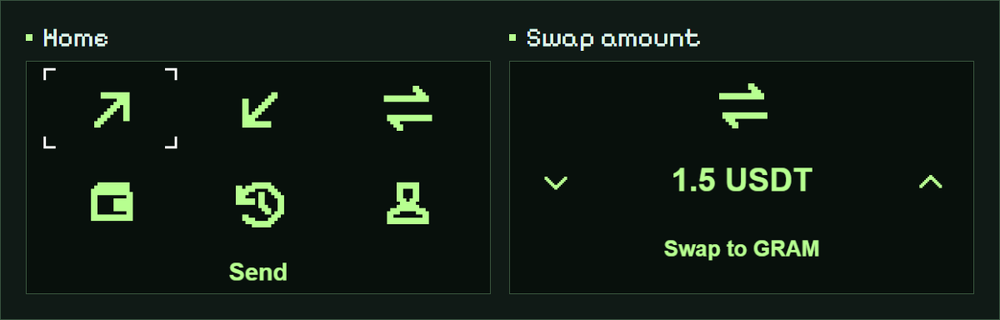

# Gram Grid

A TON wallet for **Even G2 glasses and the R1 ring**. Pick a contact, set an amount with a swipe, and review the transfer in the lens. Your phone holds the encrypted signing key and shows the QR code when someone wants to pay you.



## Try it without glasses

From the repository root, use Node.js 22.13+ on the 22.x line (or Node.js 24) and npm.

```sh
npm ci
npm run lab
```

Open the [phone and virtual glasses side by side](http://127.0.0.1:5186/app/?emulator=1). The same command starts the official Even Hub simulator. Its phone window pairs with the [3D glasses and ring view](http://127.0.0.1:5186/). Each environment keeps its own wallet.

**First run.** Mainnet is selected by default and uses real funds. For a practice run, select **Testnet** on the phone, choose **Create**, write down the 12 words, then confirm the three requested words. The lens switches from the setup prompt to the six-icon grid. Open **Send**, tap to choose GRAM, and swipe **Up** twice to see **0.2 GRAM**. Hold to return home. This walkthrough requires no funds.

## Inside the grid

| Action | What you can do |
| --- | --- |
| **Send** | Choose GRAM or USDT, set an amount, then select a contact, scan a payment QR with the phone camera, or enter an address. Review before signing. |
| **Receive** | Show or share the phone’s QR. The same TON address accepts both assets on Mainnet. The lens shows a shortened address and new confirmed receipts while the app is running. |
| **Swap** | Exchange GRAM and USDT through STON.fi. Review the estimated output, minimum received, and quote expiry before confirming. |
| **Balance** | Check both holdings and their combined USD estimate. Balances come from TON Center and prices from CoinGecko. |
| **History** | Browse finalized transfers for the current address. |
| **Contacts** | Add a name and address on the phone, then select that person in the lens. Each network has its own address book. |

**Network support.** Mainnet supports GRAM, USDT on TON, and swaps in both directions. Testnet supports native GRAM transfers. The same recovery phrase derives a different address on each network.

## Ring and temple controls

| Gesture | In the wallet |
| --- | --- |
| **Swipe up / down** | Move through the grid or a list. On a Send or Swap amount, **Up adds 0.1** and **Down subtracts 0.1** of the selected asset. |
| **Tap** | Open the selected item or accept the current step. On the review screen, tapping the selected checkmark confirms the operation in an unlocked session. |
| **Long press** | Return to the home grid. While the system menu is open, select **Home** there. |
| **Menu** | Choose **Back**, **Home**, or **Lock wallet**. Send and Swap provide a dedicated amount menu. |

The amount menu starts with **Max**, followed by **−0.1, −1, −10, +0.1, +1, +10**, **Reset to 0**, **Back**, and **Home**. For a GRAM transfer, Max leaves 0.02 GRAM for fees. For a swap, it also accounts for the GRAM required by the quoted route. USDT operations need GRAM for fees.

<details>
<summary><strong>Recovery, locking, and transaction tracking</strong></summary>

- **Create or import.** Recovery uses 12 English BIP-39 words. During creation, three incorrect checks trigger three new word positions, with unlimited attempts. In **Import**, paste the full phrase into any word field and set a device password.
- **Local custody.** The phone derives an Ed25519 key at <code>m/44′/607′/0′</code> for TON Wallet V5R1. The vault in IndexedDB uses AES-256-GCM and a password-derived key (PBKDF2-SHA256, 600,000 iterations). Use localhost, HTTPS, or the installed Even App webview for wallet access.
- **Session lock.** Restarting the app or spending five minutes idle locks signing. **Lock wallet** does this immediately. The address, balance, and receive QR remain available.
- **Pending transfers.** Before broadcasting, Gram Grid saves the signed message hash locally. If the network response is lost, the app can resume checking TON Center for the transaction.

</details>

## Build and test

```sh
node --test local-wallet.test.js
npm run pack
```

The test runs in a local TON Sandbox. It restores a wallet, deploys its V5R1 contract with the first payment, and verifies a second payment. The build produces **`gram-grid.ehpk`** for Even Hub SDK 0.0.16. To run it on hardware, pair your G2 with Even App 2.2.10 or later and install the package through Even Hub. [Local installation guide](https://hub.evenrealities.com/docs/test/local-testing) · [Official simulator guide](https://hub.evenrealities.com/docs/test/simulator)
